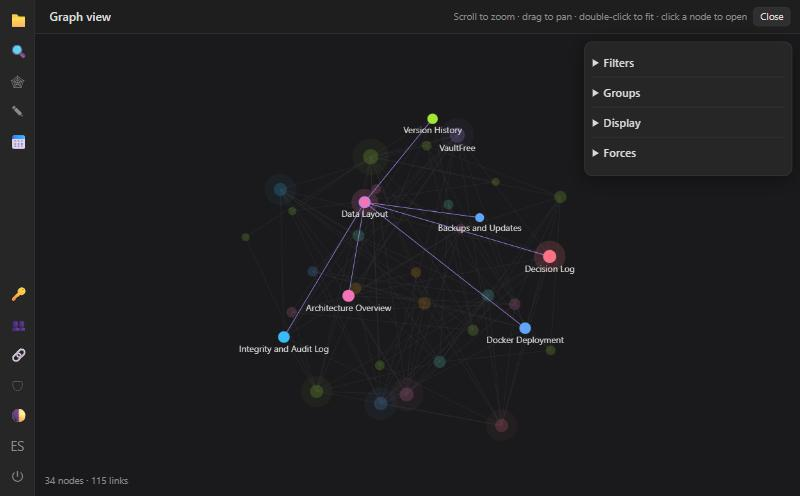
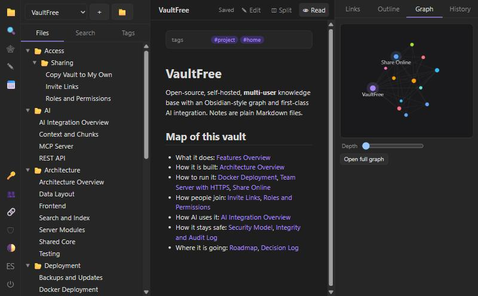

<div align="center">

# VaultFree

**A self-hosted, multi-user knowledge base with an Obsidian-style graph view and first-class AI integration.**

Plain Markdown files · wikilinks & backlinks · live graph · teams without lost edits · REST + MCP for AI agents

[](https://github.com/OWNER/vaultfree/actions/workflows/ci.yml)
[](LICENSE)




</div>

> VaultFree is an independent open-source project inspired by the note-taking workflow popularised by Obsidian. It is not affiliated with or endorsed by Obsidian.

## Why VaultFree

- **Your notes stay yours.** A vault is just a folder of `.md` files. Open the same folder in Obsidian, edit it with git, back it up with `cp`.
- **Built for more than one person.** Accounts, roles, live updates, and a three-way merge on save, so two people (or a person and an AI agent) editing at once never overwrite each other.
- **Built for AI.** Scoped API tokens, a built-in [MCP server](#ai-integration) (stdio **and** HTTP), LLM-ready context packs, and RAG-ready chunks.
- **Nothing to install but Docker.** No database, no build step, **zero runtime dependencies** (Node.js only).

<div align="center">

</div>

## Features

| | |
|---|---|
| **Notes** | Obsidian-compatible Markdown: `[[wikilinks]]`, `[[Note#Heading\|alias]]`, `![[embeds]]`, nested `#tags`, frontmatter, callouts, task lists, tables, backlinks, rename-with-link-update |
| **Graph view** | Force-directed canvas: hover to highlight neighbours, zoom/pan/drag, filters (search, tags, orphans, unresolved), colour groups, force & display sliders, local graph per note |
| **Folders** | Nested folders, empty folders, drag & drop notes and folders, rename/move with automatic link updates |
| **Teamwork** | Roles (viewer / editor / owner), live updates (SSE), presence avatars, full version history with restore |
| **No lost edits** | Every save carries the revision it started from; stale saves are three-way merged, real conflicts are shown, never overwritten |
| **Sharing** | One-click invite links (read or edit, expiry optional), copy a vault to your own, optional public HTTPS link |
| **AI** | REST API, MCP (stdio + HTTP), `/context`, `/chunks`, JSONL export, `/llms.txt` |
| **Integrity** | Content-addressed history (SHA-256), hash-chained audit log, `vaultfree verify` |
| **Interface** | Light/dark themes, command palette, quick switcher, English & Spanish |

## Quick start

### Docker (recommended)

```bash
git clone https://github.com/OWNER/vaultfree.git
cd vaultfree
docker compose up -d
```

Open <http://localhost:3000> and create the first account — it becomes the administrator. A "Welcome" vault with linked starter notes is created for you. Data lives in the `vaultfree-data` Docker volume.

By default only your own computer can reach it, so it is safe to try. Update with `git pull && docker compose up -d --build`.

### Without Docker

```bash
git clone https://github.com/OWNER/vaultfree.git && cd vaultfree
npm start            # http://127.0.0.1:3000 — Node.js 20+, nothing to install
```

## Use it with a team

| I want to… | Do this |
|---|---|
| Use it alone | `docker compose up -d` |
| Invite people | In the app: **🔗 Invite & share** → create an invite link. They pick a username and password and land in the vault. Sign-up can stay closed. |
| Run a permanent team server | Set `VAULTFREE_DOMAIN=notes.example.com` in `.env`, point your DNS at the machine, then `docker compose --profile https up -d`. Caddy gets and renews the HTTPS certificate automatically. |
| Reach it from my LAN | `VAULTFREE_BIND=0.0.0.0` in `.env` |
| Share a link for a demo | Admin → **🔗 → Start sharing online** opens a temporary public HTTPS address (needs the bundled `cloudflared`; the address changes each time) |

Roles: **viewer** reads, **editor** writes, **owner** manages members, invites and settings. Owners can also disable copying/export for members. Details in [docs/DEPLOYMENT.md](docs/DEPLOYMENT.md).

## AI integration

VaultFree treats agents as normal collaborators: same permissions, same conflict-safe writes.

1. Create a token in the app (**🔑**). Tokens are read-only or read+write and can be limited to vaults.
2. Connect a client.

**MCP over HTTP** (Claude Code, Cursor and other clients that support HTTP MCP with a bearer header):

```bash
claude mcp add --transport http vaultfree http://localhost:3000/mcp \
  --header "Authorization: Bearer vf_YOUR_TOKEN"
```

**MCP over stdio** (Claude Desktop and others):

```json
{ "mcpServers": { "vaultfree": {
  "command": "node",
  "args": ["/path/to/vaultfree/bin/vaultfree.js", "mcp",
           "--url", "http://localhost:3000", "--token", "vf_YOUR_TOKEN", "--vault", "welcome"]
} } }
```

Tools: `vaultfree_search`, `vaultfree_read_note`, `vaultfree_write_note`, `vaultfree_append_note`, `vaultfree_graph_neighbors`, `vaultfree_get_context`, `vaultfree_list_notes`, `vaultfree_list_tags`, `vaultfree_list_vaults`.

**REST** for scripts and pipelines — see [docs/API.md](docs/API.md). Handy endpoints: `/context?q=…` (an LLM-ready pack of the most relevant notes), `/chunks` (heading-aware RAG chunks), `/export?format=jsonl`. Agents can read `/llms.txt` for a machine-readable summary.

## How collaboration stays lossless

1. `GET note` returns `{content, rev}` where `rev` is the SHA-256 of the content.
2. `PUT note {content, baseRev: rev}`.
3. If someone else saved in between, the server loads your base version from its content-addressed store and **three-way merges** (`shared/merge.js`). A clean merge is saved and returned with `merged: true`.
4. Overlapping edits return `409 conflict` with `current`, `yours` and `mergedWithMarkers`; the UI offers *Keep mine / Use theirs / Merge manually*.
5. `POST /ops/append` never conflicts — ideal for agent logs and quick capture.

## Your data

```
data/
├── auth.json                    users, token/session/invite hashes
└── vaults/<id>/
    ├── *.md, folders/           your notes — open them in Obsidian too
    └── .vaultfree/              history (by hash), trash, audit log, settings
```

You can edit the folder with Obsidian or git while VaultFree runs: outside changes are detected and merged, never overwritten. In Docker this is the `vaultfree-data` volume; back it up by copying it. `vaultfree verify` checks every note, every stored version and the audit chain.

## Security

scrypt password hashes · HttpOnly SameSite cookies · Origin-based CSRF checks · strict CSP · escaped Markdown rendering · path-traversal protection · hashed tokens and invites (shown once) · login throttling · sign-up closed by default · non-root container. Report vulnerabilities as described in [SECURITY.md](SECURITY.md).

## Configuration

| Variable | Default | Purpose |
|---|---|---|
| `VAULTFREE_DATA` | `./data` | data directory (`/data` in Docker) |
| `VAULTFREE_PORT` / `VAULTFREE_HOST` | `3000` / `127.0.0.1` | listen address (Docker image: `0.0.0.0`) |
| `VAULTFREE_ALLOW_SIGNUP` | `false` | allow anyone to self-register |
| `VAULTFREE_USERS_CAN_CREATE_VAULTS` | `true` | non-admins may create vaults |
| `VAULTFREE_PUBLIC_URL` | – | public address; an `https://` value enables secure cookies and proxy trust |
| `VAULTFREE_DOMAIN` | – | docker compose: domain for the `https` profile |
| `VAULTFREE_BIND` | `127.0.0.1` | docker compose: host interface to publish on |
| `VAULTFREE_TUNNEL_TOKEN` | – | optional: run a *named* Cloudflare tunnel for a permanent address |

## Project layout

```
bin/       CLI: serve, user, verify, mcp
server/    HTTP API, vaults, search & graph, auth, audit log, MCP
shared/    parsing, link resolution, 3-way merge (runs on server AND in the browser)
web/       frontend: vanilla ES modules + canvas graph, no build step
test/      node:test suites
docs/      API, deployment
```

## VaultFree vs Obsidian

VaultFree is **not** a replacement for the Obsidian desktop app: it is a web app for sharing a knowledge base with people and AI agents.

| | Obsidian | VaultFree |
|---|---|---|
| Plugin ecosystem, canvas, mobile apps | ✅ | ❌ (see roadmap) |
| Local-first desktop editing | ✅ | ❌ (web, but files stay plain Markdown) |
| Multi-user with roles, invites, merge-on-save | via paid sync | ✅ built in |
| Self-hosted, open source, zero dependencies | ❌ | ✅ |
| Built-in REST + MCP server | via plugins | ✅ |

## Development

```bash
npm test         # parsing, merge, vaults, API, auth, folders, MCP, invites
npm run dev      # restart on changes
npm run verify   # data integrity check
```

CI runs the tests on Linux and Windows (Node 20 and 22) and builds the Docker image.

## Roadmap

- [ ] Semantic search (embeddings)
- [ ] Live co-editing (CRDT) beyond merge-on-save
- [ ] OAuth for remote MCP clients
- [ ] Plugin API and canvas boards
- [x] Graph, wikilinks, backlinks · multi-user merge · invites · folders · MCP stdio + HTTP · EN/ES

## Contributing

Issues and pull requests are welcome — see [CONTRIBUTING.md](CONTRIBUTING.md) and the [Code of Conduct](CODE_OF_CONDUCT.md). The project intentionally has no runtime dependencies and no build step; please keep it that way.

## License

[MIT](LICENSE) © VaultFree contributors
